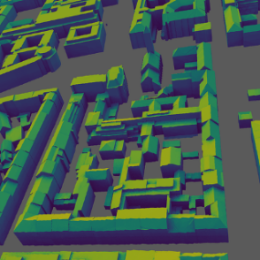

# openpv at the International Energy Agency Workshop

We were invited to present our open-source package `simshady` at the Workshop of the International Energy Agency - Solar resource for high penetration and large scale applications. 

<!-- more -->

This was at a perfect timing, since `simshady` has a CLI now and can be used on the server to simulate the shading and PV yield of large areas, like whole cities. In parallel to this talk, we published the whole dataset of simulation results for the city of Munich on zenodo.

## Related links:
- [simshady Documentation page](https://open-pv.github.io/simshady/)
- [Munich simulated dataset](https://doi.org/10.5281/zenodo.18742161)

